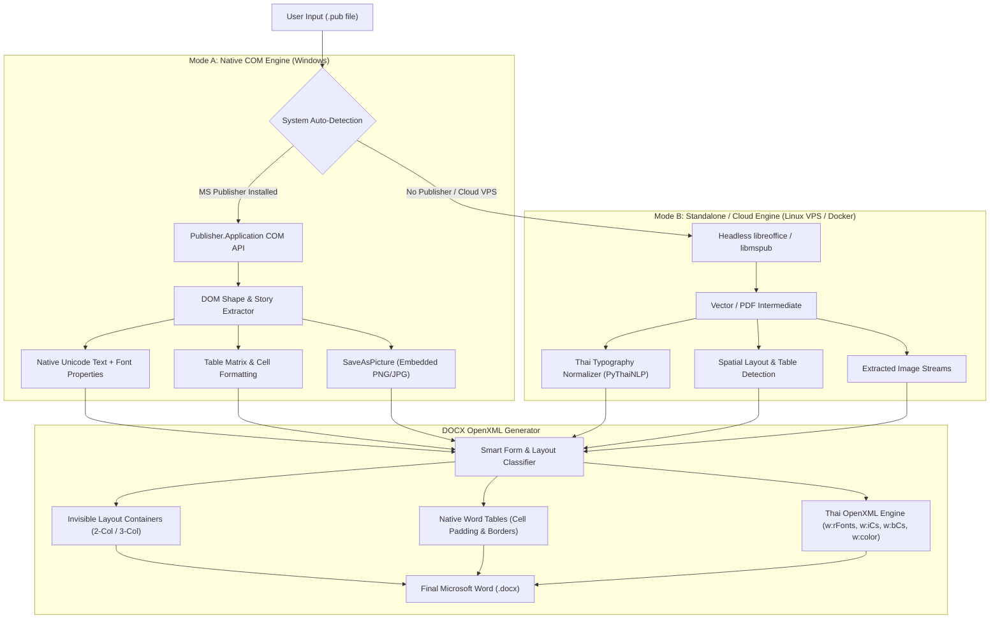

# Product Requirements Document (PRD)
## Project Name: Pub2Doc (Desktop Studio & Cloud SaaS)
**Version:** 1.0.0  
**Date:** October 2026  
**Status:** Approved / In Development  
**Author:** DeepMind Agentic Pair Programmer & Solution Architect  

---

## 1. Executive Summary & Problem Statement

### 1.1 Context
In October 2026, Microsoft officially retired **Microsoft Publisher**, ending support and removing it from Microsoft 365 licensing. Over three decades, millions of organizations, government offices, educational institutions, and businesses in Thailand have created mission-critical business forms, invoices, receipts, tax certificates, brochures, and announcements in the proprietary `.pub` binary format.

### 1.2 The Problem
Current migration methods fail catastrophically:
1. **Export to PDF $\rightarrow$ Open with Microsoft Word:**
   - **Thai Typography Destruction:** Thai is a Complex Script (CS). During PDF rasterization/vectorization, vowels (สระบน/ล่าง) and tone marks (วรรณยุกต์) are split into individual positioned glyphs or mapped to Private Use Area (PUA) codes. Word's PDF reflow engine separates diacritics, floats vowels, or displays tofu square boxes (`□`).
   - **Artificial Spacing (Ghost Spaces):** Thai has no spaces between words. Word misinterprets micro-tracking/justification spacing in PDFs as ASCII space characters (`0x20`), outputting fragmented text like `ส ว ั ส ด ี ค ร ั บ`.
   - **Form Layout Collapse:** Multi-column layouts (e.g., Customer on left, Date on right, 3 signature blocks at bottom) collapse into disjointed vertical paragraphs.
   - **Broken Tables:** Vector lines in PDFs are not native tables; Word guesses borders incorrectly, scrambling row alignment.
2. **Generic Online Converters:**
   - Rely on basic Linux `libmspub` pipelines without installed Thai fonts (TH Sarabun, Browallia, Angsana) or Complex Script OpenXML tags, stripping colors, italics, and layout hierarchy.
   - Present serious security/privacy risks when handling confidential financial invoices.

### 1.3 The Solution: Pub2Doc
Pub2Doc is a dual-engine conversion platform designed to convert `.pub` documents into native `.docx` files while guaranteeing:
- **100% Thai Unicode integrity** (zero dropped vowels, zero displaced tone marks).
- **Exact structural form layout preservation** (side-by-side metadata and signature blocks via invisible layout containers).
- **Native Word tables** (true tabular grid data, cell alignments, borders, and column widths).
- **High-resolution image extraction** (embedded logos, stamps, and signatures extracted at native fidelity).
- **Dual deployment flexibility:** A lightweight Windows Desktop Studio app (offline) and a containerized Cloud SaaS service (Docker/VPS).

---

## 2. Product Objectives & Target Audience

### 2.1 Core Objectives
1. **Fidelity:** Maintain visual and logical equivalence with original `.pub` publications.
2. **Thai Script Perfection:** Full compliance with Thai OpenType Complex Script shaping (`<w:cs>`, `<w:rFonts>`, `<w:bCs>`, `<w:iCs>`).
3. **Editable Outputs:** Outputs must be clean, editable Word documents (not static non-editable full-page images).
4. **Resilience:** Operate seamlessly on machines with MS Publisher installed (via COM API) and on machines without Publisher (via headless containerized fallback engines).

### 2.2 Target Personas
- **Accounting & Administrative Staff:** Converting invoices, receipts, and purchase orders containing financial tables, Thai numeral words, and digital signatures.
- **School & Academic Staff:** Migrating certificates, diplomas, student ID templates, and parent newsletters.
- **IT Administrators:** Mass batch-migrating thousands of archived `.pub` files into `.docx` format before retiring older workstations.
- **SaaS Internet Users:** Small business owners needing quick online conversion via mobile or web browser without installing software.

---

## 3. System Architecture

---

## 4. Functional Specifications

### 4.1 Ingestion & Environment Auto-Detection
- **FR-1.1:** System shall accept `.pub` files (Microsoft Compound File Binary Format) via file chooser, drag-and-drop, or REST API upload.
- **FR-1.2:** System shall verify whether Microsoft Publisher COM automation is available:
  - If registered: System activates **Engine A (Native High-Fidelity COM)**.
  - If unregistered: System smoothly cascades to **Engine B (Standalone Fallback)** without crashing.
- **FR-1.3:** System shall support multi-file selection and recursive folder scanning for **Batch Conversion**.

### 4.2 Thai Typography & Complex Script Engine
- **FR-2.1:** All text extracted shall preserve true Unicode codepoints (U+0E01 - U+0E5B).
- **FR-2.2:** The OpenXML generator MUST inject `<w:rFonts>` containing `w:cs="TH Sarabun PSK"` (or matching Thai font) alongside `w:ascii` and `w:hAnsi`.
- **FR-2.3:** Diacritic and tone mark rendering rules:
  - Vowels: สระอะ (ะ), สระอา (า), สระอำ (ำ), สระอิ (ิ), สระอี (ี), สระอึ (ึ), สระอือ (ื), สระอุ (ุ), สระอู (ู), ไม้หันอากาศ (ั).
  - Tone marks: ไม้เอก (่), ไม้โท (้), ไม้ตรี (๊), ไม้จัตวา (๋), การันต์ (์).
  - Normalization: Must pass through `pythainlp.util.normalize()` to eliminate detached Sara Am (` ำ`) or out-of-order mark sequences.
- **FR-2.4:** Complex Script Italic & Bold:
  - For bold: Must write both `<w:b/>` and `<w:bCs/>`.
  - For italic: Must write both `<w:i/>` and `<w:iCs/>`. (Ensures Thai text visually tilts in Microsoft Word).
- **FR-2.5:** Text Color:
  - Extract Windows `COLORREF` integer (`0x00bbggrr`), convert to RGB hexadecimal string (`RRGGBB`), and apply via `<w:color w:val="RRGGBB"/>`.

### 4.3 Smart Form Layout Classification
- **FR-3.1:** Spatial Band Clustering: Group elements into horizontal coordinate bands based on vertical overlap (`Top` to `Top + Height`).
- **FR-3.2:** Header Block:
  - Split elements with $X < 300$ pt (Left: Company Name, Address, Phone) and $X \ge 300$ pt (Right: Logo image, Tax ID).
  - Render inside a 1-row $\times$ 2-column borderless layout table.
- **FR-3.3:** Customer & Invoice Metadata:
  - Left column: Customer details, address, Tax ID.
  - Right column: Invoice Date, Payment Due Date, Quotation Ref.
  - Render inside an invisible 2-column container.
- **FR-3.4:** Signature Block:
  - Cluster signatures into 3 horizontal zones ($X < 200$, $200 \le X < 350$, $X \ge 350$).
  - Render as a 3-column table:
    - Row: Role Title (`ผู้จัดเตรียม`, `ผู้มีอำนาจลงนาม`, `ผู้รับเอกสาร`).
    - Row: Extracted signature picture or dotted signature line `(...........................................)`.
    - Row: Approval Date.

### 4.4 Table Engine
- **FR-4.1:** Read dimensions ($M$ rows $\times$ $N$ columns) and extract cell contents, font styling, and horizontal alignment.
- **FR-4.2:** Proportional column width mapping: Convert Publisher points to inches to guarantee tables fit within standard A4 margins (7.0 in printable width).
- **FR-4.3:** Data cell alignments:
  - Index/Item number/Quantity $\rightarrow$ Center.
  - Descriptions $\rightarrow$ Left.
  - Prices/Amounts/Totals $\rightarrow$ Right.
- **FR-4.4:** Cell padding: Apply uniform vertical and horizontal cell padding (`w:tcMar`) of 60-80 dxa for clean legibility.

### 4.5 Asset & Image Extraction
- **FR-5.1:** Extract all embedded raster graphics (`msoPicture` / Type 13) at native resolution using `SaveAsPicture()`.
- **FR-5.2:** Store extracted images in dedicated project `extracted_images/` directory.
- **FR-5.3:** Embed pictures into Word runs with scaled width/height preserving original aspect ratio.

---

## 5. User Interfaces & Access Channels

### 5.1 Desktop Studio (Windows)
- **Framework:** Python Tkinter + `sv-ttk` (Sun Valley modern Windows 11 Fluent UI).
- **Components:**
  - Status Indicator: `🟢 MS Publisher Detected (v16.0)` or `🟡 Standalone Fallback Active`.
  - File Selection: Multi-file picker (`+ เพิ่มไฟล์ .PUB`) and folder picker (`📁 เพิ่มทั้งโฟลเดอร์`).
  - Interactive TreeView: List of files with real-time status (`รอการแปลง`, `⏳ กำลังแปลง...`, `✅ สำเร็จ`, `❌ ผิดพลาด`).
  - Output Folder Selector with "📂 เปิดโฟลเดอร์" quick-access button.
  - Progress Bar with percentage counter.
  - Live Scrollable Execution Console Log.
  - One-click launcher: `Run_Pub2Doc.bat`.

### 5.2 Web Application & Cloud Service (FastAPI)
- **Framework:** FastAPI + Tailwind CSS + Vanilla JS Drag & Drop.
- **Endpoints:**
  - `GET /`: Serves mobile-responsive web dashboard with upload dropzone.
  - `POST /api/convert`: Multipart form upload accepting `.pub`, returning JSON `{ status, filename, download_url }`.
  - `GET /api/download/{filename}`: Direct stream download of `.docx` file.
  - `GET /api/health`: Healthcheck endpoint for VPS monitoring.

---

## 6. Non-Functional Requirements (NFR)

| Category | Requirement | Target Metric |
| :--- | :--- | :--- |
| **Performance** | Conversion speed for standard 1-page invoice/flyer | $< 2.5$ seconds |
| **Batch Throughput** | 100 documents batch conversion | $< 4$ minutes |
| **Output File Size** | Optimized DOCX size with embedded images | $< 1.5 \times$ original `.pub` size |
| **Page Budget** | Single-page forms must not spill onto Page 2 | Exactly 1 A4 Page ($210 \times 297$ mm) |
| **Privacy & Security** | Cloud service temporary files retention | Automatically purged after 60 minutes |
| **Reliability** | Process isolation to prevent orphaned COM processes | Force-kill zombie `MSPUB.exe` on startup/exit |
| **Portability** | Cloud deployment | Single-command Docker Compose deployment |

---

## 7. Cloud VPS Deployment Specification

### 7.1 Linux VPS Container Setup (Ubuntu 22.04 / 24.04)
- **Docker Base Image:** `python:3.11-slim`
- **Linux Packages:**
  - `libreoffice-writer`, `libreoffice-draw` (provides `libmspub` decoding).
  - `fonts-thai-tlwg`, `fonts-liberation`, `fonts-dejavu` (guarantees Thai font metrics).
- **Python Dependencies:** `fastapi`, `uvicorn`, `python-docx`, `pymupdf`, `pythainlp`, `pillow`, `python-multipart`.
- **Reverse Proxy:** Caddy / Nginx with automated Let's Encrypt SSL.

---

## 8. Release Roadmap & Milestones

### Phase 1: MVP Desktop Engine (Completed)
- [x] Reverse-engineer Publisher COM DOM extraction.
- [x] 100% Thai Unicode extraction without character corruption.
- [x] Complex Script OpenXML font styling (Italic `<w:iCs>`, Bold `<w:bCs>`, Hex Color).
- [x] Smart Form Layout Reconstruction (Invoice layout, 6x6 Table, 3-column signatures).
- [x] Modern Windows 11 Desktop GUI with batch conversion and auto-detect status.

### Phase 2: Web Service & VPS Enablement (Current)
- [x] FastAPI backend with drag-and-drop web dashboard.
- [x] Dockerfile and Docker Compose configuration.
- [ ] Auto-purge cron worker for temporary uploads/outputs.
- [ ] Multi-page booklet layout support.

### Phase 3: Enterprise & Mass Migration Tools
- [ ] Command-line CLI tool (`pub2doc --batch "D:/Archive" --output "D:/Docx"`).
- [ ] Active Directory / LDAP authentication for corporate portal.
- [ ] Optical Character Recognition (OCR) fallback for raster-only legacy `.pub` files.
